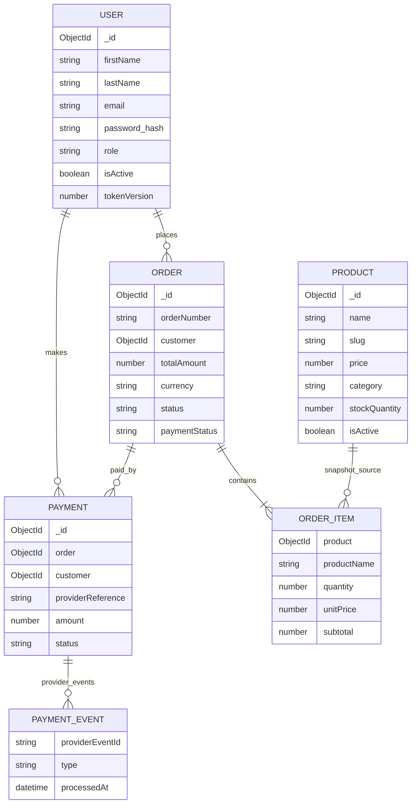

# Data relationships

Order items keep a product name and price snapshot. A subsequent product edit
does not change a previously placed order. Product references are retained for
traceability and inventory reservation/release.
